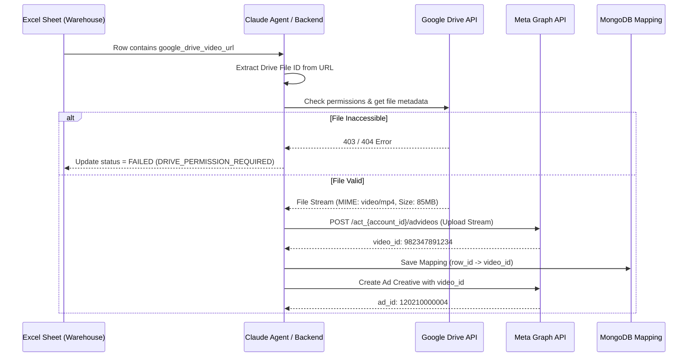

# Google Drive Media Pipeline for Meta Ads Creative

This document details the retrieval, validation, and upload lifecycle of media assets referenced in the Excel Sheet via Google Drive links.

---

## 🔄 Media Processing Lifecycle

---

## 📋 Media Validation Rules

Before uploading to Meta Marketing API:

1. **Format Compatibility**:
   - Videos: `video/mp4`, `video/quicktime` (.mov).
   - Images: `image/jpeg`, `image/png`.
2. **Size Limits**:
   - Video max file size: 4GB.
   - Image max file size: 30MB.
3. **Aspect Ratios**:
   - Feed: 1:1 or 4:5.
   - Stories & Reels: 9:16.
4. **Token Refresh**:
   - Transparently refresh OAuth access token if expired using the stored refresh token.
